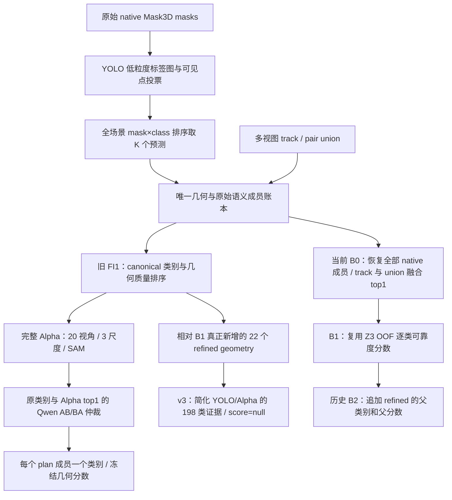

# 第二创新点：系统链路审计与重设计依据

日期：2026-09-09。性质：代码、已登记结果与论文交叉审计；不是新实验结果或生产启用通知。

## 1. 结论与审计范围

当前问题不能归结为“没有用 Qwen”“Alpha 太弱”或“只差 top-k”。项目已实现并运行过完整 Alpha 路径与 Qwen 仲裁，也曾取得收益。真正需要解决的是：**保留下来的几何、语义候选、视觉证据和 AP 排序目标没有在同一条链路中完整衔接。**

本轮完整阅读 `资料/论文阅读记录.md`、`资料/第二创新点精读论文.md`；结合交接、方法方向、结果表、状态文件的相关历史章节与终止记录，追踪原始 OpenYOLO3D、FI1、旧 DM-SMS-1、Z1/Z2/Z3、当前 B0/B1/B2/v3 的关键入口、调用函数和输出合同。不是对所有历史脚本逐行完成运行时验证；没有重跑视觉模型、训练、GT 诊断或 AP，没有读取 validation60/val312 数据集。本报告中的实验数字均引用已有记录。

路径约定：

- **M**：主仓库 `/home/jia/Wm/wm_open-yolo/OpenYOLO3D`，存放当前交接、论文笔记、v2.2 终止代码及本报告。
- **W**：实际开发工作树 `/home/jia/Wm/wm_open-yolo/worktrees/OpenYOLO3D-geometry-semantic-56b2c25`，分支 `local-fi1-geometry-semantic-official100-20260908`，HEAD `65f7fc3061b382af59e292f49475b6bb6749b29b`，含尚未提交的当前修改。
- 以下实现引用默认指 W；标为 M 的路径指主仓库。两者同名文件不能假定内容相同。

## 2. 三条实际运行链路

**旧链路去重后保留所有 FI1 plan 成员，不等于保留了所有原始 native 语义预测列。** 上游 canonical 选择已经折叠过语义。当前 B0/B1 才恢复原 native 成员；v3 又是尚未形成生产评分的独立证据分支。

## 3. 已确认的实现事实与限制

| 环节 | 代码实际行为 | 对第二点的影响 |
|---|---|---|
| 原始语义 | `utils/__init__.py:335`、`:446`：bbox 按宽+高降序绘制标签图，后绘的小框覆盖大框；投影可见点投票。top-k 分支按每个 mask 最大类票数归一化，再展平 mask×class 全场景取 K | 当前 native 缓存已保留这一结果；不能说整个项目丢失了标签图。新证据应单独复现它 |
| 三种 k | 配置中的 topk=40 是视角数，YOLO topk=100 是二维框数，topk_per_image=600 是场景预测列预算 | 600 不是每个 mask 都分配 600 类，也不是每个 mask 固定 top-5。增加逐 mask 候选后必须明确最终预算 |
| 原始最终分数 | top-k 分支覆盖前面的 `class_prob*iou_prob` 分数，3D objectness 也没有在此分支直接相乘 | 不能把原始最终分数误写成 YOLO confidence×几何质量 |
| FI1 语义折叠 | `dm_sms_core.py:42`、`build_dm_sms1_unique_geometry_ledger.py:369` 选 canonical；`build_fi1_d_v3_frozen_inference_plan.py:542` 使用 canonical 类；`build_dm_sms1_fi1_d_v3_prediction_cache.py:117` 输出 frozen 类与 challenger_score | 类别成员在 Qwen 前就丢失；类别无关排序分数也被用于逐类 AP |
| 完整 Alpha 已有 | `build_dm_sms1_alpha_view_manifest.py`、`build_dm_sms1_alpha_embedding_ledger.py:154`：最多 20 视角、3 尺度、SAM、特征级聚合、完整 cosine 矩阵 | 不需要从零重写完整 Alpha。真正缺口是当前分支复用及完整分布向下游传递 |
| Alpha 下游 | 账本保留完整 similarities，但 `alpha_class_index` 取 argmax；M 的 `evaluate_dm_sms1_stage_e_gt.py:162` 用单类和 unit/frozen geometry score | 编码器具备全类别证据，不代表最终输出保持多语义 |
| Qwen 候选 | `build_dm_sms1_semantic_arbitration_manifest.py:121`：canonical 类 + Alpha argmax，最多 2 类 | 原类别与 Alpha 第一名都错时，Qwen 无法补出第三个正确类 |
| Qwen 视觉输入 | `run_dm_sms1_single_scene_vlm_smoke.py:77`：全图红框+局部 crop 双面板，不渲染 SAM 轮廓；batch 复用该函数，各阶段仍看图。像素上限用于整个拼图 | 有场景上下文，不能说只看 crop；但实际目标分辨率、目标归属和上下文利用仍需检查 |
| Qwen 属性约束 | 属性步骤禁止猜测类别；随后 AB/BA 只评两个候选 | 该合同是受约束仲裁，不能等同于独立开放词汇识别 |
| Qwen 动作 | `apply_dm_sms1_semantic_arbitration.py:67`：替代类双支持且无强反证才换成一个类，保留原分数 | AB/BA 稳定不等于正确；即便换类正确，分数也未针对新类校准 |
| 当前 B0 | `build_official100_fi1_b0_control.py:50`：59997 个 native 原成员；5265 track 和1501 union 用继承的 YOLO/Alpha 等权融合 argmax | B0 是历史增强混合控制，不是原生 OpenYOLO3D-only；“完整多语义”只表示保留已有成员，不表示所有来源都扩展为多类 |
| 当前 B1 | `build_official100_fi1_b1_b2_manifests.py:70`：59823 前景 native 与5265 track 复用历史 Z3；174 sentinel、1501 union 分数冻结 | 不是本轮新训练的 FI1 语义模型。FI1 分数只登记，未进入实际 B1 评分；union 未统一校准 |
| B2/v3 | 历史42条 plan 实际22个新几何；历史 B2 继承父类别/分数；v3 全类证据 score=null | 当前没有一个已经训练、验证的全系统“FI1+多语义+Qwen”评分器 |
| 新 YOLO 证据 | `export_fi1_refined_semantic_evidence.py:230` 调用 Z1 `_frame_evidence`：每类取 confidence×框内点比例，不同类别重叠框同时计入 | 与标签图的覆盖式归属不同；不能无声替换为“同一种 YOLO 证据” |
| Z2 Alpha 聚合 | `build_z2_unified_semantic_node_ledger.py:56`：逐视角 logits softmax 后平均 | 与完整 Alpha 的特征聚合再 cosine 不同；不是 softmax(mean logits) |
| union 证据来源 | Z2 同时存 own/inherited evidence；B0 union 固定类别用 inherited，通常来自关联 track | FI1 几何改变并不自动触发目标语义更新；应保留 own/parent 的差别 |

低粒度标签图也可能错覆盖、漏长尾；复用其价值在于保留强基线证据并做同几何比较，不能预先认定它优于所有框内统计。

### 3.1 训练与评测目标存在可复现的不一致

W/M `tools/build_z3_semantic_reliability_dataset_gt.py:167,266` 使用 float32 `np.arange(.50,.951,.05)`，包含0.95，共10档，并使用 `>=`。W/M evaluator `evaluate/scannet200/eval_semantic_instance.py:81,173,209` 使用 `np.arange(.5,.95,.05)`，实际是0.50至0.90，共9档，匹配使用严格 `>`；0.25 单独报告。B0/B1/B2 evaluator 调用的就是这条评测链。

已在 openyolo3d 环境仅计算常量数组确认，不访问 GT。此差异不只是边界等号问题：例如 IoU=0.92，在当前评测质量代理中通过全部9档，旧 Z3 目标只通过9/10档。float32 阈值还存在约1e-7的偏移。

新训练若声称拟合当前 AP 质量，应复用 evaluator 的阈值与严格比较；保留旧目标作为历史模型定义，不改历史 evaluator 或重新解释既有 AP。实际影响样本数和 AP 尚未量化。Z3 的同类最大 IoU 质量或可选一对一代理，也不等于官方 AP 的忽略规则和重复预测处理。

### 3.2 需要继续核验、不能现在判为缺陷的部分

- B1 读取的历史 OOF 分数与训练输入的逐层场景隔离；仅行上有 fold 标记不足以证明整个 FI1/Z3 组合无泄漏。
- `release_assets/z3_semantic_reliability/summary.json` 明确是 official100 full-fit 发布模型，不能用于回放 official100 OOF 并声称无泄漏。
- SAM bbox prompt 对父/子几何是否生成相同二维目标、实际 processor 后目标是否足够可辨，需要受控视觉检查；尚未证明是全局主因。
- 本报告没有证明所有历史 scores 的统计尺度兼容，也没有把文件哈希一致当成模型输出可重放。

## 4. Qwen 与 Alpha 确实有过收益，但不能混用参照系

| 已登记比较 | AP，百分数 | 能支持的结论 |
|---|---:|---|
| NCS-train100：冻结控制→完整 Alpha 单类 | 29.286523→30.880755 | 完整 Alpha 对旧单类体系有效；不能说模型无用 |
| NCS-train100：冻结控制→DM-SMS-1 | 29.286523→34.7491 | 含 Alpha/Qwen 的旧组合方案有效；不是 Qwen 单模块净增益 |
| NCS-validation60：旧控制→DM-SMS-1 | 27.3387→32.2663 | 旧受限体系有历史迁移收益；本轮只读登记结果 |
| val312 A100：FI1-D-v3控制→DM-SMS-1 | 19.4586→22.4607 | Qwen 组合补回一部分损失，仍低于论文原生24.7；控制的表示/分数不同，不能精确归因给 top-1 |
| official100：B0→B1 | 30.311670→32.755740 | 在相同候选和类别下重评分有效，不是新增多语义类别的独立增益 |
| 早期完整多语义联合控制→加Qwen | 25.4155→25.4147 | 旧 Qwen 对较强参照系不保证产生收益 |
| Z6c 直接 selector | 28.236506，对照32.755740 | 现有候选内直接换类失败 |
| Z6d nested 改善接受门槛 | 31.889356，对照32.755740 | 再加接受门槛仍失败，不能作为全新建议重复 |
| Z6f 选择性 Qwen | official100 +0.053051；safety60 -0.00525 | 小开发收益未稳定迁移 |
| DM-SMS v2.2 双强反证 | 7006任务，0换类 | 更严格仲裁退化为不动作，不应继续机械收紧 |

旧 Qwen 7006任务有894条严格无效，其中429条涉及有限候选外类别。这证明接口会拒绝候选外识别，**不证明这429条识别正确**。v2.2 5017条有效、1989条回退仍零换类；属性/否定合同过强与类别间语义重叠都是需要考虑的因素。

Z6a 的 YOLO+Alpha top-5 并集 GT-only oracle 为43.285077 AP，说明已有证据中存在可利用信息；它不是可实现的增益保证。直接 selector 和 gate 的失败说明“正确类在集合里”远不足以解决最终 AP。

v3.3 的22几何只是局部诊断：IoU>0.5 的16个匹配中，融合top1命中8、两源top5并集命中15；相对 B1 无新增几何目标覆盖，新增同类覆盖仅1。不能将它们当成全系统训练集，或据 projector 排名6临时把 k 调成6。

## 5. 论文到底提供了什么不同的信息

### Details Matter（2025，而非2026）

原文：[arXiv 2507.23134v1](https://arxiv.org/html/2507.23134v1)。20视角、3尺度、SAM、对象特征聚合；ScanNet200 的2D+3D单标签25.8，多标签32.7。表7记录 CLIP27.5→Alpha30.5→SMS32.7。

项目已有前半段完整工程，但下游使用 Alpha argmax 和单类分数合同。因此首要任务是接通完整分布，不是重复造编码器。论文的 SMS 在本项目历史 Stage E 小幅掉分并触发集中性问题，不能直接照搬删除策略。论文附录的单位置信与top-K需要结合具体实现理解；本轮未逐行审计其公开评测代码，不据此声称其最终分数与本项目相同。

### OpenTrack3D（v3，2026-05-14）

原文：[arXiv 2512.03532v3](https://arxiv.org/html/2512.03532v3)，§3.3、§4.1、表4、附录6。

- 明确采用 **Top-1** 评测，top-k 论文结果以星号区分；不能说2026论文都不用top1。
- 使用 Qwen3-VL-4B；ScanNet200 选择3个代表视角，全图红框，直接在完整给定类别表中识别，允许 none。
- 提示为“Identify the object shown in the red rectangle. Return the class name from {}. If no object is shown, return ’none’”。
- 同框架分类头消融：CLIP22.9/33.4/39.8→MLLM26.0/37.7/45.4。

它支持的迁移是“让 MLLM 提供独立目标识别能力”，不是“必须换成 Qwen3”或“必须把最终输出改成top1”。可以先保持本项目 Qwen2.5、相同图像预算比较直接识别与属性二选一；MLLM 即使每次只提议一个类，也可以只向最终多语义集合补充证据。

### OV3D-CG（ICCV2025）

[CVF正式页面](https://openaccess.thecvf.com/content/ICCV2025/html/Zhou_OV3D-CG_Open-vocabulary_3D_Instance_Segmentation_with_Contextual_Guidance_ICCV_2025_paper.html)与[作者项目页](https://vipl-vsu.github.io/OV3D-CG/)本轮已核实。正式摘要明确：选择最佳视角，构建三种包含上下文的二维表示，交给 MLLM 以 Chain-of-Thought 方式推理。

笔记记录 crop15.5、完整场景SAM高亮22.7；PDF下载本轮超时，这两个具体数值未重新核对原表，不作为本报告推荐的定量依据。当前 Qwen 已有全图上下文；值得比较的是目标标记、上下文组织和识别任务，而不是再添加一个已有的“全图输入”开关。

### 两份笔记中的其他方向

SAS 支持独立来源与可靠度校准；质量感知排序与 AP/ranking 文献提示目标应包含类别和定位；MPEC 提醒语义一致不等于实例可合并。GVC/多视图一致性可提供连续质量输入。否定提示、自评 confidence、过度 abstain 和反事实研究不能被简化成固定阈值换类；已有 v2.2 正是反例。当前不优先重开几何底座、MLLM 微调或新增视觉主干。

## 6. 为什么几何更好、实例 AP 仍可能下降

对预测 (mask m, 类别 c, 分数 s)，逐类 AP 同时依赖：mask 能否匹配、c是否正确、s能否把TP排在FP前、同类重复是否增加。类别无关 AP 把类别差别消掉，也改变了候选竞争和匹配的任务。它不是语义 AP 的单调代理，更不能与分类准确率直接相乘。

本项目存在四条具体机制：

1. **正确类被上游折叠掉**：再好的几何输出错误类别，该类下仍是 FP。
2. **几何质量代替了类别可靠度**：几何很好的错误类得到高分，伤害逐类精度；换类后原分数又未适配新类。
3. **FI1 改善没有传入视觉证据**：union 继承 track 语义，或父/子投影经 crop/SAM/resize 后差别减弱。v3.3同帧Alpha目标类排名0改善、1变差、19不变提供了局部证据，不能外推所有实例。
4. **改进的是已有目标的另一份预测**：覆盖未增加、分数未把更优mask排上去时，追加只可能增加同类竞争。FI1 D 的类别无关前缀边际分数也不能无条件用作所有类别的冗余惩罚。

现有运行同时改变了多项因素；还没有完成保持其余因素不变的因果拆分，因此不能给这些机制分配“各解释多少 AP”。

## 7. 建议的第二点：利用 FI1 的对象结构做多源逐类证据与排序

### 7.1 先统一证据与来源，覆盖整个候选系统

对象以 scene+实际点集身份去重；证据再绑定视角、二维目标mask、crop、模型、词表、prompt和聚合版本。输出保持 mask×class 的多个假设。先保留所有 legacy 成员，不改变历史 B0/B1/B2 定义；原生 native-only 与历史增强 B0 分开报告。

为 native、track、union、refined 统一保存三类证据：

- 原始低粒度标签图投票；框内比例分布作为另一个独立字段，不能覆盖。
- 复用已有完整 Alpha 编码器的全类别相似度、视角/尺度离散度、有效性，按实际几何重新绑定。不能仅因候选ID相同便复用不同点集的旧特征。
- own/parent/core/removed 的受控对照以及缺失状态；保留 v3.2 的真实 mask_transform 有效性检查，不预设 core 更可靠。

先接入现有5265条track、1501条union以及native的新增类别假设，22个refined只是其中一部分。完整198类用于证据与审计；不等于把198类都赋高分输出。新候选预算在看结果前冻结，和场景最终K区别记录。

### 7.2 Qwen 从两类替换器改成独立识别证据源

新增直接识别接口：目标标记的多视图RGB + 完整评测词表，返回合法类别或unknown，附视角依据；保留旧属性/ABBA为控制。先使用现有 Qwen2.5-VL-7B，避免同时改变模型、图像与任务。

输出首先写入证据账本，不直接覆盖旧类别或分数。候选外正确识别才有机会加入集合；重复识别到已有类时用于加强/削弱其证据。自报confidence和ABBA一致不能直接当成AP分数。unknown/格式失败表示本源缺失，B1回退。

另设受控图像对照：全场景+明确目标轮廓与独立局部图，审计 processor 后目标像素；保持场景上下文。红框本身不是缺陷，OpenTrack3D也用红框；是否需要SAM轮廓必须看目标混淆，而不是预设轮廓必胜。视角从覆盖、遮挡、尺度、视向多样性挑选；旧相机中心距离仅是代理。

推理可对少量有视觉证据但语义冲突的对象路由；**路由规则不能取代代表性诊断**。受控样本须覆盖高置信/低置信、长尾、来源和失败回退，避免只评少量容易成功的对象。先比较识别贡献，再决定部署预算。

### 7.3 用 FI1 改善目标证据与同类排序

FI1 A 的独立几何质量适合输入评分器；FI1 C 提供对象、共同支持区、删除区和来源分歧；FI1 B/D 的重叠关系适合构建同类竞争上下文。不要把 D 的类别无关 challenger_score 直接复制给每个类。

特别检查几何变化能否到达图像：如果父/子bbox相同，纯bbox提示SAM可能返回相同区域。优先保留可见投影支持点及SAM重叠质量，必要时再比较来自FI1区域的正/负提示，不能把“removed”全部默认成背景。否则FI1几何创新与语义创新依然脱节。

目标评分是共享函数 `s(m,c)=g(基础分数, 各源逐类证据, 独立几何质量, 证据有效性, 同类重叠上下文)`。Z3已经是41特征的共享函数，不把“共享逐类模型”包装成尚未实现的新方法。新意应来自前述FI1证据与竞争关系，而非简单再加一个GBDT。

已有类从B1分数学习残差是可比较方案；新增类没有B1分数，须显式缺失并用共同校准尺度学习，不能复制父score或把0当可靠负例。同类更优mask应有机会前移，错误类和重复mask应后移；不直接硬删 B1，也不预设几何质量与语义独立后相乘。

### 7.4 训练合同与最终输出

代表性样本包括全部来源的既有候选，以及通过/未通过门槛的refined与退化例；以场景/独立几何计样本量。22×198不等于4356个独立样本。所有受监督上游要在外层留出内重新拟合/产生训练证据，记录模型、场景、训练特征与预测回放身份。

新目标从实际 evaluator 的阈值和匹配语义出发，明确最大IoU代理与真实AP差异；同时报告类别宏平均、来源、折间变化和重复风险。新增信号先证实有增量，再增加排序模型复杂度，避免重复 Z6 selector/gate。

两种输出合同必须分开：历史B2继续append-only；任何全场景固定K的新系统另命名、另建manifest，并与同预算控制比较。不能全局topK后删去B1成员，却继续声称“完整保留B1”。多语义协议作为主评测，Top-1可以做额外消融。

## 8. 具体修改顺序与验收

| 顺序 | 应修改/复用的位置 | 交付与停止条件 |
|---|---|---|
| P0 | 分离账本、B0/B1 builder 的元数据；新增只读系统来源清单 | 明确native-only/增强B0、所有成员、几何/类别/分数来源；zero-change输出与B1逐列一致 |
| P1 | 复用 `construct_label_maps`、完整Alpha view/embedding；扩展v3证据适配 | 在相同几何上并存baseline vote、bbox evidence、fullAlpha；输入/点空间/crop/词表可复核，缺失不补父类别 |
| P2 | 新建独立Qwen直接识别manifest/runner/evidence adapter，复用已有模型加载器 | 原属性二选一 vs 完整词表识别，先固定模型和视角；所有动作先输出score=null，无证据不动作 |
| P3 | Z3 dataset/训练的新版本；FI1质量及同类关系adapter | 修正新目标合同、上游嵌套隔离、保存fold模型并回放；有代表性证据才训练，不用22几何独立校准 |
| P4 | 独立版本的prediction builder和evaluator合同 | 先重放B1，再逐项增加证据/评分；同预算、同几何控制与新增几何收益分别报告 |

最小对照顺序：强控制B1→同输出合同增加完整Alpha/标签图证据→固定前项增加Qwen独立识别证据→增加FI1条件评分。每一步需保存配对输入和输出；不同时改变提示、视觉模型、K与评分器。fullAlpha与标签图若均接入，应分别开关对照，不能把捆绑增益归给其中一个。

这些是有代码和历史证据支撑的优先假设，**尚未证明能超过当前B1**。本轮仅落地系统审计、可追溯来源快照与文档纠错；未修改推理/训练代码，未启动新的GPU/GT/AP运行。生产B2 `--calibration-root` 继续禁用。

## 9. 本轮留存与验证

- [来源清单](experiment_summaries/fi1_system_audit_20260909/source_inventory.json)：37个代码/配置/历史记录/笔记文件的实际路径与SHA-256；其中29个W下Python文件完成AST解析。解析仅证明语法可解析，不证明所有导入或运行时策略正确。
- [阈值合同检查](experiment_summaries/fi1_system_audit_20260909/threshold_contract_check.json)：直接提取源码中的常量表达式，在openyolo3d环境计算阈值及4个合成IoU例子；没有导入项目推理模块或访问数据集。
- `.local/fi1_system_audit_20260909/`另存Details Matter、OpenTrack3D的HTML/文本以及OV3D-CG正式摘要/项目页，共6份来源快照。OV3D-CG不完整PDF不作为原文精读完成的证据。
- 已检查本轮文档的本地Markdown链接与diff空白；更新根交接、方法方向、两份论文笔记和状态文件。历史结果及旧运行文件没有改写，未提交或推送。
